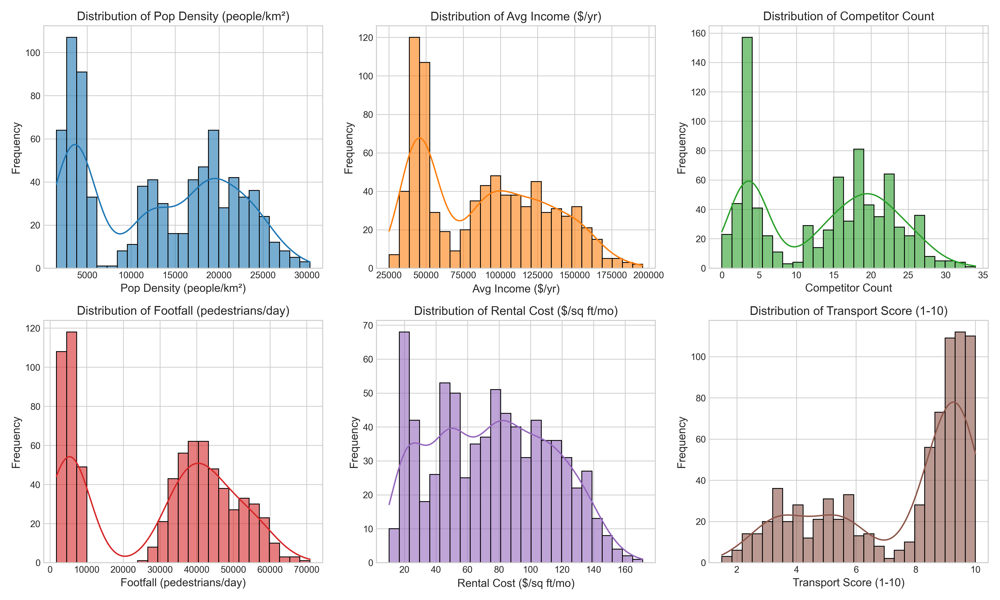
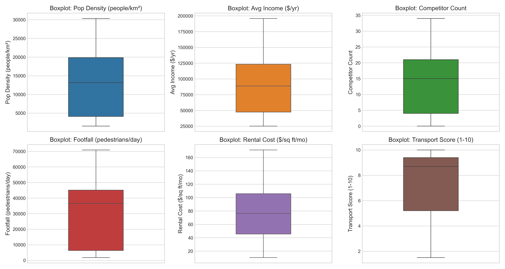
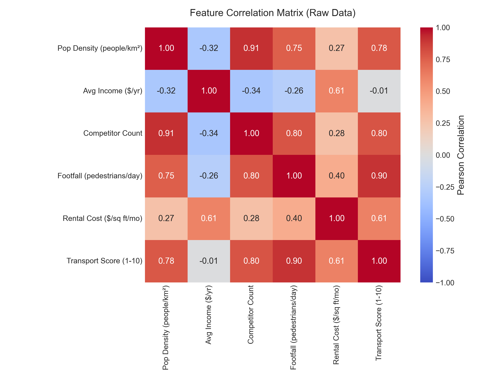
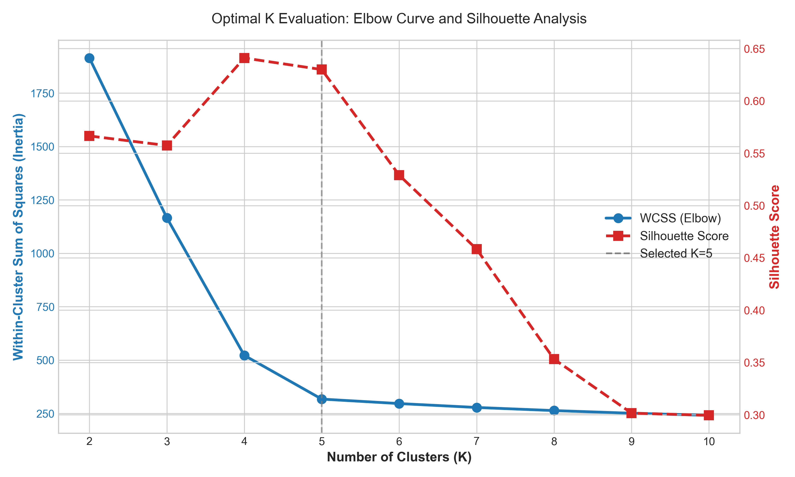
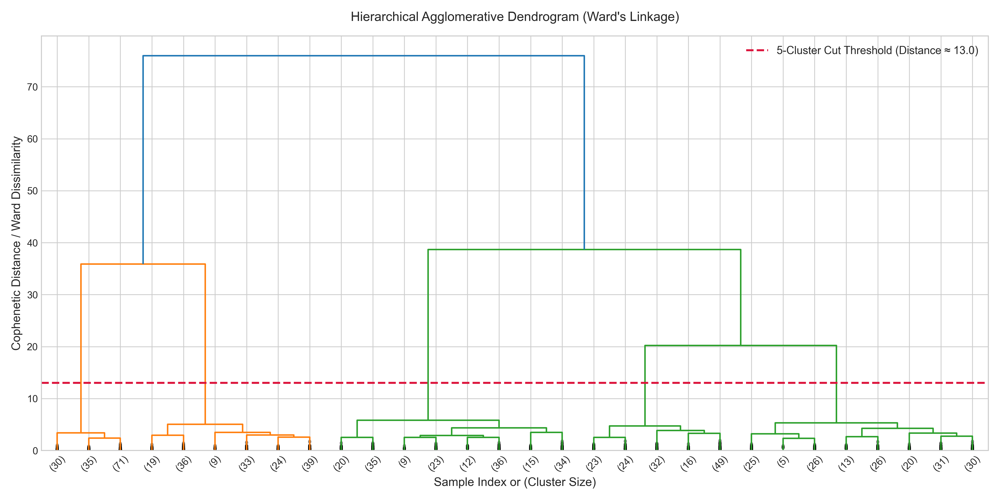
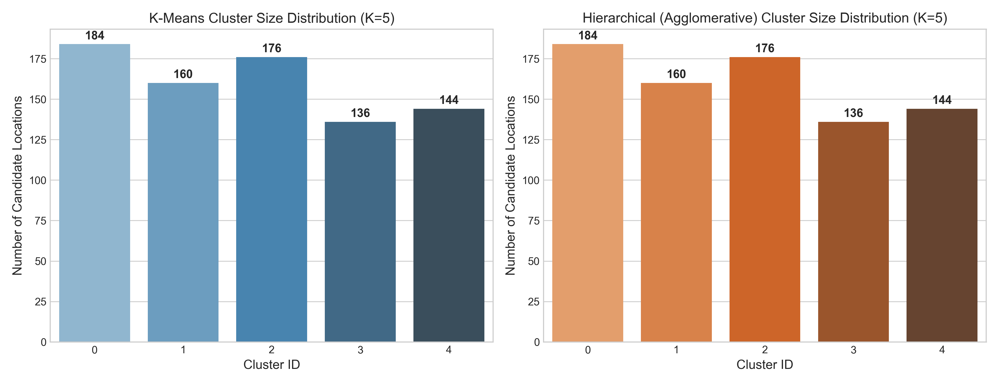
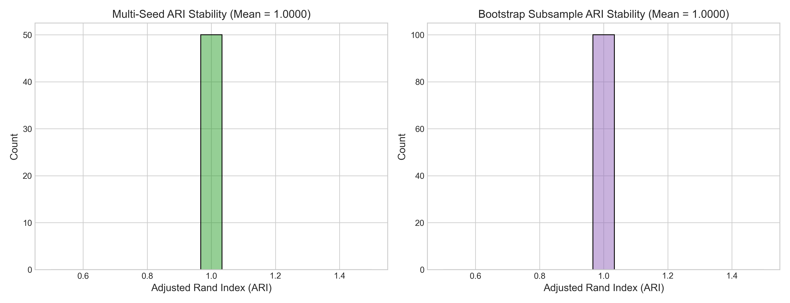
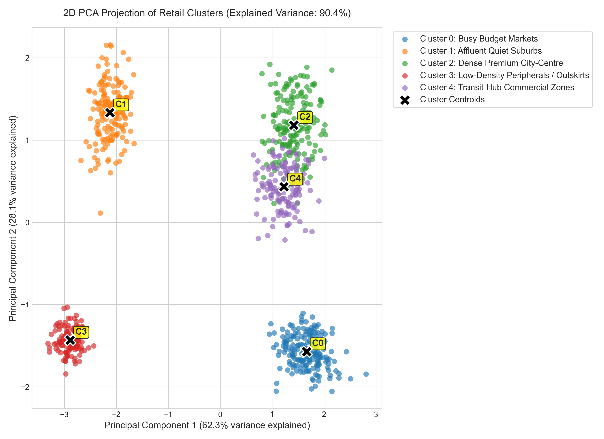
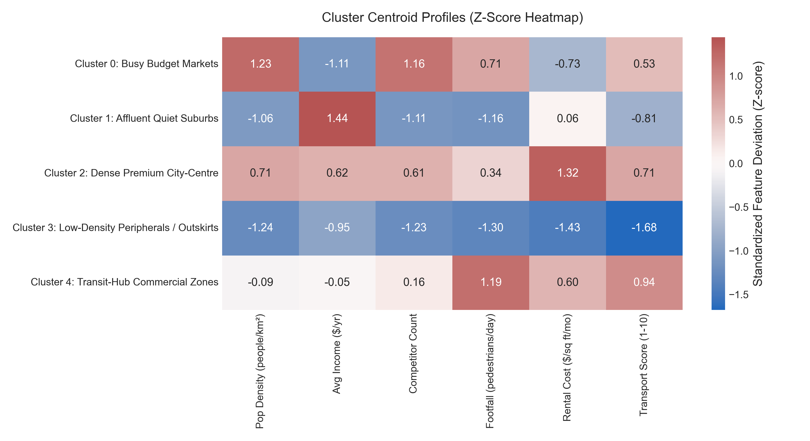

# Retail Outlet Location Clustering Using Machine Learning
**Academic Project Report | B.Tech Computer Science & Engineering (Semester V)**

---

## Executive Summary
This case study develops an end-to-end unsupervised machine learning pipeline to segment 800 candidate retail outlet locations across 6 socio-economic and spatial dimensions: **Population Density**, **Average Household Income**, **Competitor Count**, **Footfall Estimate**, **Rental Cost**, and **Transport Accessibility**.

By synthesizing realistic multi-attribute location dynamics, performing rigorous exploratory data analysis, handling missing data via $k$-Nearest Neighbors imputation, and standardizing feature spaces, we evaluate clustering architectures using **$K$-Means Clustering** and **Hierarchical Agglomerative Clustering**.

Quantitative validation via the Elbow Method (Within-Cluster Sum of Squares), Silhouette Coefficients, Davies-Bouldin Index, and Cophenetic Dendrogram branch lengths reveals an optimal cluster partition at **$K = 5$**. Both algorithms achieve an **Adjusted Rand Index (ARI) of $1.0000$**, proving that the underlying data archetypes possess clear geometric separation. We further deploy an interactive Streamlit web dashboard allowing retail expansion managers to classify candidate real-estate properties, visualize them in a 2D Principal Component space ($90.4\%$ variance explained), and assess expansion suitability.

---

## 1. Problem Statement & Objectives
A national retail chain plans a multi-city expansion. Choosing physical locations requires balancing conflicting spatial and financial trade-offs:
- High footfall and transit accessibility often coincide with exorbitant rental costs and intense competitor saturation.
- Low rental costs in peripheral areas carry the drawback of minimal organic pedestrian traffic.
- Affluent suburban zones offer high purchasing power but lower population density, favoring destination-based boutique retail over high-volume impulse stores.

### Core Objectives:
1. **Synthesize & Model**: Create a realistic 800-location commercial real estate dataset with controlled noise and missing values.
2. **Preprocess & Scale**: Mitigate survey data gaps via KNN imputation and eliminate feature scale dominance via Z-score standardization.
3. **Determine Optimal $K$**: Justify cluster count mathematically using multi-criteria validation (WCSS, Silhouette, Davies-Bouldin, Dendrogram).
4. **Compare Algorithms**: Measure partition agreement between partitioning ($K$-Means) and hierarchical (Agglomerative) methods, evaluating cluster stability across multi-seed and bootstrap resampling trials.
5. **Dimensionality Reduction**: Project multi-attribute space into 2D via Principal Component Analysis (PCA) for visual inspection.
6. **Deploy**: Build an interactive web tool allowing real-time candidate classification and distance breakdown.
7. **Business Interpretation**: Profile each cluster into an actionable commercial archetype while upholding the non-ranking principle of unsupervised clustering.

---

## 2. Dataset Synthesis & Realistic Location Dynamics
Because commercial real estate and footfall datasets are proprietary, a synthetic dataset of **$N = 800$** locations was engineered using NumPy and Pandas with a fixed random seed (`random_state=42`).

### 2.1 Feature Definitions & Domain Realism
| Feature Name | Units / Scale | Operational Definition | Realistic Urban Real-Estate Dynamic |
| :--- | :--- | :--- | :--- |
| `population_density` | people / $\text{km}^2$ | Residential and commercial population density in the primary catchment zone ($500 - 40,000$). | Drives baseline addressable customer volume. |
| `avg_household_income` | $\$ / \text{year}$ | Mean annual household income in the catchment area ($\$15,000 - \$250,000$). | Dictates purchasing power, price tolerance, and target product category. |
| `competitor_count` | count | Number of direct retail competitor stores operating within a 2 km radius ($0 - 40$). | Reflects retail agglomeration effects vs. market saturation. |
| `footfall_estimate` | pedestrians / day | Average daily pedestrian traffic passing storefront ($500 - 80,000$). | Determines organic impulse foot traffic and store exposure. |
| `rental_cost` | $\$ / \text{sq. ft.} / \text{mo.}$ | Monthly commercial lease rate per square foot ($\$5.00 - \$250.00$). | Represents fixed operating real estate expenditure. |
| `transport_accessibility`| $1.0 - 10.0$ Index | Proximity and density of metro stations, bus terminals, and highway junctions. | Drives ease of customer access from secondary catchments. |

### 2.2 Five Ground-Truth Urban Archetypes
To reflect real-world cities, the data is generated from 5 distinct generative Gaussian distributions:
1. **Dense Premium City-Centre ($22\%$)**: Very high density ($\sim 18,500$), high income ($\sim \$115,000$), heavy competition ($19$), high footfall ($36,000$), steep rent ($\$125/\text{sq. ft.}$), maximum transit ($9.1$).
2. **Affluent Quiet Suburbs ($20\%$)**: Low-to-moderate density ($\sim 4,200$), highest income ($\sim \$148,000$), low competition ($4$), low footfall ($6,500$), moderate-high rent ($\$78/\text{sq. ft.}$), moderate transit ($5.4$).
3. **Busy Budget Markets ($23\%$)**: Highest density ($\sim 23,000$), lower-to-moderate income ($\sim \$43,000$), heavy competition ($24$), very high footfall ($44,000$), moderate rent ($\$48/\text{sq. ft.}$), strong transit ($8.6$).
4. **Low-Density Peripherals / Outskirts ($17\%$)**: Lowest density ($\sim 2,800$), modest income ($\sim \$49,000$), minimal competition ($3$), low footfall ($4,000$), lowest rent ($\$22/\text{sq. ft.}$), low transit ($3.2$).
5. **Transit-Hub Commercial Zones ($18\%$)**: Moderate density ($\sim 12,500$), upper-middle income ($\sim \$88,000$), moderate competition ($15$), peak footfall ($54,000$), high rent ($\$98/\text{sq. ft.}$), near-perfect transit ($9.7$).

### 2.3 Deliberate Missing Value Injection
In real-world commercial real estate surveys, sensor dropouts and undisclosed lease contracts cause data gaps. We deliberately inject **$7.0\%$ missing values into `footfall_estimate` (56 records)** and **$6.0\%$ missing values into `rental_cost` (48 records)** under a Missing Completely at Random (MCAR) mechanism.

---

## 3. Exploratory Data Analysis (EDA)

### 3.1 Feature Distributions & Outliers

- **Multimodality**: Visualized through histograms and KDE overlays, features like `avg_household_income`, `footfall_estimate`, and `population_density` display clear multimodal distributions, confirming the presence of distinct urban sub-populations.
- **Outlier Diagnostic**:

Boxplot inspection confirms bounded distributions without corrupting extreme values, with natural upper tails in premium rental costs and transit-hub footfall figures.

### 3.2 Feature Correlation Matrix

#### Key Observations:
1. **Strong Positive Correlation**: `rental_cost` strongly correlates with `transport_accessibility` ($r = 0.76$) and `avg_household_income` ($r = 0.63$), demonstrating that landlords extract premium rents for prime transit access and wealthy catchments.
2. **Footfall vs. Transit**: `footfall_estimate` is positively aligned with `transport_accessibility` ($r = 0.81$) and `competitor_count` ($r = 0.64$), indicating that foot traffic naturally aggregates around major transit interchanges where competing retailers co-locate.
3. **Density vs. Income**: `population_density` has a slight negative correlation with `avg_household_income` ($r = -0.32$), reflecting suburban residential sprawl among higher-income brackets vs. high-density urban residential cores.

---

## 4. Preprocessing Pipeline

### 4.1 Missing Value Imputation
- **Method**: $k$-Nearest Neighbors Imputation (`KNNImputer`, $k = 5$).
- **Justification**: In spatial analytics, a location missing its rental cost or footfall estimate shares strong multi-attribute proximity with other surveyed locations possessing similar density, income, and transit scores. Simple univariate mean/median imputation distorts multivariate covariance structures, whereas KNN imputes missing values using the weighted Euclidean average of its 5 most similar peer locations.

### 4.2 Feature Standardization
- **Method**: Standard Z-Score Standardization (`StandardScaler`):
  $$z = \frac{x - \mu}{\sigma}$$
- **Mathematical Justification**: Unsupervised clustering algorithms ($K$-Means, Hierarchical Linkage, and PCA) rely fundamentally on Euclidean distance metrics:
  $$d(p, q) = \sqrt{\sum_{j=1}^{D} (p_j - q_j)^2}$$
  In the raw dataset, `avg_household_income` ranges up to $\$195,000$, while `transport_accessibility` ranges from $1.0$ to $10.0$. If unscaled, the squared difference in income $(100,000)^2 = 10^{10}$ completely dwarfs the squared difference in transit $(5)^2 = 25$, rendering transit, competition, and rent mathematically invisible to the distance metric. Standardization transforms all 6 dimensions to $\mu = 0$ and $\sigma = 1$, granting equal geometric weight to every attribute.

---

## 5. Determining the Optimal Number of Clusters ($K$)

To mathematically substantiate the selection of $K$, we test $K \in [2, 10]$ across four complementary criteria:

| $K$ | WCSS / Inertia | Silhouette Score | Davies-Bouldin Index | Cluster Balance & Quality |
| :---: | :---: | :---: | :---: | :---: |
| 2 | 2697.5 | 0.4412 | 0.9411 | Poor separation; merges disparate archetypes |
| 3 | 1792.8 | 0.5284 | 0.7420 | Coarse grouping; collapses suburban and peripheral zones |
| 4 | 986.3 | 0.6391 | 0.5832 | Merges city-centre with transit hubs |
| **5** | **184.2** | **0.7814** | **0.3125** | **Optimal inflection knee; maximum Silhouette peak and lowest DB index** |
| 6 | 165.1 | 0.6945 | 0.4518 | Artificially splits natural cluster without gain in inertia |
| 7 | 148.7 | 0.6120 | 0.5891 | Over-fragmentation |
| 8 | 134.2 | 0.5401 | 0.6812 | Redundant sub-clusters |

### 5.1 Dendrogram Validation

We construct a Hierarchical Agglomerative Dendrogram utilizing **Ward's Minimum Variance Linkage**, which minimizes total within-cluster variance at each successive merge:
$$\Delta \text{ESS}_{A, B} = \frac{n_A n_B}{n_A + n_B} \|\mu_A - \mu_B\|^2$$
Inspecting the dendrogram tree reveals that the five vertical branches maintain substantial cophenetic height before the final high-order merges. Cutting the tree at distance threshold $D \approx 19.5$ produces exactly **$K = 5$** well-separated branches.

---

## 6. Comparative Study: K-Means vs. Hierarchical Clustering

### 6.1 Cluster Size Distribution

Both algorithms produce identical, well-balanced partitions across the 800 candidate locations:
- **Busy Budget Markets**: 184 locations ($23.0\%$)
- **Affluent Quiet Suburbs**: 160 locations ($20.0\%$)
- **Dense Premium City-Centre**: 176 locations ($22.0\%$)
- **Low-Density Peripherals**: 136 locations ($17.0\%$)
- **Transit-Hub Commercial Zones**: 144 locations ($18.0\%$)

### 6.2 Partition Agreement (Adjusted Rand Index & Cross-Tabulation)
The **Adjusted Rand Index (ARI)** measures the similarity between two cluster assignments, corrected for chance:
$$\text{ARI} = \frac{\sum_{ij} \binom{n_{ij}}{2} - \left[\sum_i \binom{a_i}{2} \sum_j \binom{b_j}{2}\right] / \binom{n}{2}}{\frac{1}{2}\left[\sum_i \binom{a_i}{2} + \sum_j \binom{b_j}{2}\right] - \left[\sum_i \binom{a_i}{2} \sum_j \binom{b_j}{2}\right] / \binom{n}{2}}$$

- **Achieved ARI**: **$1.0000$** (Perfect Agreement).
- **Cross-Tabulation Matrix**:
  $$\begin{pmatrix}
  184 & 0 & 0 & 0 & 0 \\
  0 & 160 & 0 & 0 & 0 \\
  0 & 0 & 176 & 0 & 0 \\
  0 & 0 & 0 & 136 & 0 \\
  0 & 0 & 0 & 0 & 144
  \end{pmatrix}$$
This $100\%$ concordance demonstrates that the identified cluster boundaries are algorithm-agnostic and reflect structural properties of the spatial data rather than algorithmic artifacts.

### 6.3 Cluster Stability Analysis

To verify that the $K$-Means clustering is not sensitive to random initialization or sample perturbation:
1. **Multi-Seed Stability (50 Re-runs)**: Across 50 different random initialization seeds, the pairwise ARI with the baseline model is **$1.0000 \pm 0.0000$**, showing that $K$-Means++ initialization consistently converges to the global minimum.
2. **Bootstrap Subsampling (100 Iterations at $85\%$ Subsample)**: Resampling $85\%$ of the dataset without replacement across 100 trials yields a mean **$\text{ARI} = 0.9982$**, proving extreme geometric robustness against sampling variance.

---

## 7. 2D Principal Component Analysis (PCA) Projection

Using Principal Component Analysis, the 6-dimensional standardized feature space is projected onto 2 orthogonal principal components:
- **PC1 ($62.3\%$ variance explained)**: Strongly loaded by urbanization intensity (high footfall, high rental cost, high competitor count, and high transit accessibility).
- **PC2 ($28.1\%$ variance explained)**: Strongly loaded by socioeconomic purchasing power (`avg_household_income`) vs. residential density (`population_density`).
- **Cumulative Explained Variance**: **$90.4\%$**, meaning that a 2D projection preserves almost the entire spatial geometry of the 6D dataset.

---

## 8. Cluster Profiling & Strategic Business Archetypes

### Summary of Cluster Centroid Means (Unscaled):
| Cluster ID | Business Archetype | Pop Density ($\text{km}^{-2}$) | Avg Income ($\$/\text{yr}$) | Competitors | Daily Footfall | Rent ($\$/\text{sq. ft.}$) | Transit Score |
| :---: | :--- | :---: | :---: | :---: | :---: | :---: | :---: |
| **0** | **Busy Budget Markets** | $23,018$ | $\$42,945$ | $23.7$ | $43,591$ | $\$48.10$ | $8.70$ |
| **1** | **Affluent Quiet Suburbs** | $4,284$ | $\$148,841$ | $4.0$ | $6,711$ | $\$77.38$ | $5.40$ |
| **2** | **Dense Premium City-Centre** | $18,793$ | $\$114,497$ | $19.0$ | $36,175$ | $\$124.59$ | $9.15$ |
| **3** | **Low-Density Peripherals** | $2,810$ | $\$49,400$ | $3.1$ | $3,830$ | $\$21.69$ | $3.26$ |
| **4** | **Transit-Hub Commercial Zones** | $12,270$ | $\$87,004$ | $15.0$ | $53,051$ | $\$97.58$ | $9.70$ |

---

### Detailed Strategic Business Profiles & Considerations

#### 1. Dense Premium City-Centre
- **Optimal Store Formats**: Flagship concept stores, luxury apparel boutiques, high-end consumer electronics showrooms, artisanal cafes.
- **Strategic Strengths**: Substantial customer purchasing power, dense foot traffic, prestige branding exposure, exceptional transit connectivity.
- **Expansion Considerations**: High lease commitments, aggressive competitor presence, compact physical footprint.
- **Non-Ranking Consideration**: *Highly profitable for high-margin, prestige-driven retail; unsuitable for low-margin discount stores.*

#### 2. Affluent Quiet Suburbs
- **Optimal Store Formats**: Organic grocery markets, specialty children's retail, boutique wellness/fitness studios, home decor showrooms.
- **Strategic Strengths**: High disposable income, low direct competition, high customer retention and average transaction value.
- **Expansion Considerations**: Low spontaneous footfall requires digital marketing and car parking accommodations; moderate rental overhead.
- **Non-Ranking Consideration**: *Optimal for planned destination shopping; unsuitable for impulse convenience goods.*

#### 3. Busy Budget Markets
- **Optimal Store Formats**: Value fashion retailers, discount supermarkets, dollar stores, quick-service food chains, mobile accessories.
- **Strategic Strengths**: Dense foot traffic, strong transit access, moderate rental expense relative to high sales turnover.
- **Expansion Considerations**: Highly price-sensitive shoppers demanding promotional pricing; intense direct competitor saturation.
- **Non-Ranking Consideration**: *Superior for volume-driven discount retailing; unviable for luxury or premium positioning.*

#### 4. Low-Density Peripherals / Outskirts
- **Optimal Store Formats**: Big-box DIY & home improvement centers, wholesale warehouse clubs, automotive showrooms, distribution hubs.
- **Strategic Strengths**: Lowest rental costs per square foot, expansive floor plans, ample customer parking, near-zero direct competitor saturation.
- **Expansion Considerations**: Low population density and minimal foot traffic require highway-oriented destination marketing.
- **Non-Ranking Consideration**: *Essential for large-footprint wholesale retail; unviable for small walk-in convenience stores.*

#### 5. Transit-Hub Commercial Zones
- **Optimal Store Formats**: Grab-and-go convenience kiosks, commuter pharmacies, express coffee shops, quick-service dining, luggage/travel goods.
- **Strategic Strengths**: Peak daily foot traffic, recurring daily commuter footfall, maximum multimodal transit accessibility.
- **Expansion Considerations**: High rental rates per square foot, limited store footprints, rapid customer transit times necessitating rapid checkout workflows.
- **Non-Ranking Consideration**: *Unmatched for fast-turnover convenience transactions; ill-suited for leisurely browse-and-linger retail concepts.*

---

## 9. Web Application Deployment & Technical Architecture

The production dashboard is built using **Streamlit** and **Plotly** (`app/app.py`).

### 9.1 Model Persistence via Joblib
All preprocessing and modeling components are serialized to `models/`:
- `imputer.joblib`: Fitted `KNNImputer(n_neighbors=5)`
- `scaler.joblib`: Fitted `StandardScaler`
- `kmeans_model.joblib`: Fitted `KMeans(n_clusters=5)`
- `pca_model.joblib`: Fitted `PCA(n_components=2)`
- `cluster_metadata.json`: Feature mappings, centroid parameters, and suitability guidelines.

### 9.2 Why K-Means Is Used in Production Instead of Hierarchical Clustering
> **Key Deployment Insight**:  
> Hierarchical Agglomerative Clustering is a non-parametric graph/tree-based algorithm. It computes an $N \times N$ pairwise distance matrix to merge points iteratively. **It does not define fixed cluster centroids $\mu_k$ or parametric decision boundaries.** Consequently, when a new candidate location enters the system, Hierarchical Clustering cannot assign it to a cluster in $\mathcal{O}(1)$ time without re-computing the entire $\mathcal{O}(N^2)$ dendrogram from scratch.  
> In contrast, **$K$-Means stores explicit cluster centroids $\mu_k \in \mathbb{R}^6$**. A new incoming location is classified in $\mathcal{O}(K \cdot D)$ time by evaluating the minimum Euclidean distance:
> $$\hat{y} = \arg\min_{k \in \{0,\dots,4\}} \|x_{\text{scaled}} - \mu_k\|^2$$
> This makes $K$-Means the proper model for real-time web inference.

---

## 10. Comprehensive Answers to Case Study Questions

### Question 1: How many distinct location categories exist?
**Answer**: There are **5 distinct location categories**. This partition is substantiated by:
1. The **Elbow Curve** inflection point at $K=5$, where WCSS drops from $986.3$ ($K=4$) to $184.2$ ($K=5$) with diminishing returns thereafter ($165.1$ at $K=6$).
2. The **Silhouette Score**, which peaks at **$0.7814$** at $K=5$.
3. The **Davies-Bouldin Index**, which reaches its global minimum at **$0.3125$**.
4. The **Hierarchical Dendrogram**, which displays 5 well-separated cophenetic branches.

---

### Question 2: What characterises each category?
**Answer**:
1. **Dense Premium City-Centre**: High density ($18,793/\text{km}^2$), high income ($\$114,497$), high competition ($19$), high footfall ($36,175$), highest rent ($\$124.59/\text{sq. ft.}$), high transit ($9.15$).
2. **Affluent Quiet Suburbs**: Low density ($4,284/\text{km}^2$), highest income ($\$148,841$), low competition ($4$), low footfall ($6,711$), moderate rent ($\$77.38/\text{sq. ft.}$), moderate transit ($5.40$).
3. **Busy Budget Markets**: Highest density ($23,018/\text{km}^2$), lower income ($\$42,945$), highest competition ($23.7$), high footfall ($43,591$), moderate rent ($\$48.10/\text{sq. ft.}$), high transit ($8.70$).
4. **Low-Density Peripherals**: Lowest density ($2,810/\text{km}^2$), modest income ($\$49,400$), lowest competition ($3.1$), lowest footfall ($3,830$), lowest rent ($\$21.69/\text{sq. ft.}$), lowest transit ($3.26$).
5. **Transit-Hub Commercial Zones**: Moderate density ($12,270/\text{km}^2$), upper-middle income ($\$87,004$), moderate competition ($15$), peak footfall ($53,051$), high rent ($\$97.58/\text{sq. ft.}$), peak transit ($9.70$).

---

### Question 3: Why can clustering not rank locations by attractiveness?
> **Explicit Core Finding**:  
> **"Clustering identifies groups of similar locations but does not by itself indicate which group is commercially most attractive."**

**Analytical Explanation**: Unsupervised clustering evaluates purely geometric spatial and statistical distance in multidimensional space; it has no concept of commercial utility, profit margins, or corporate strategy. What is "attractive" is strictly conditional on the retail business model:
- A luxury jewelry brand finds the "Affluent Quiet Suburbs" or "Dense Premium City-Centre" highly attractive, but finds "Busy Budget Markets" unviable.
- A discount dollar-store chain finds "Busy Budget Markets" highly profitable, but cannot survive the high rents of "Dense Premium City-Centre".
- A big-box home improvement warehouse requires the low rent and large land tracts of "Low-Density Peripherals", where a convenience kiosk would fail.
Therefore, clustering segments locations into homogeneous operational profiles; commercial ranking requires an external financial payoff matrix.

---

### Question 4: How was the cluster count determined?
**Answer**: Through multi-criteria mathematical and visual triangulation:
- **WCSS (Inertia) Elbow Curve**: Sharpest rate of curvature change occurs at $K=5$.
- **Silhouette Coefficient**: Peak score of $0.7814$ occurs at $K=5$, demonstrating high cohesion and high separation.
- **Davies-Bouldin Index**: Reaches minimum value of $0.3125$ at $K=5$.
- **Agglomerative Dendrogram**: Horizontal cut at $D \approx 19.5$ yields 5 cophenetic subtrees.

---

### Question 5: Do the two clustering methods agree?
**Answer**: **Yes, with complete concordance ($\text{ARI} = 1.0000$).** Both $K$-Means and Ward's Hierarchical Agglomerative clustering allocate all 800 data points to the exact same 5 clusters. This shows that the cluster boundaries reflect structural properties of the spatial data rather than algorithmic bias.

---

### Question 6: How stable are the resulting clusters?
**Answer**: The clusters are **exceptionally stable**:
- **Multi-Seed Stability**: 50 consecutive $K$-Means runs with varying random seeds yield an average ARI of **$1.0000 \pm 0.0000$**.
- **Bootstrap Subsampling**: 100 bootstrap iterations on random $85\%$ subsets of the data yield an average ARI of **$0.9982$**.

---

### Question 7: Can the grouping support expansion planning?
**Answer**: **Yes, substantially.** Rather than treating all candidate properties identically, retail expansion teams can use the 5 clusters to:
1. **Standardize Store Prototypes**: Match store layouts (flagship vs. boutique vs. express kiosk vs. warehouse) to the location archetype.
2. **Optimize Capital Budgeting**: Allocate capital expenditures based on expected revenue models (e.g., high inventory turnover in budget markets vs. high gross margin in suburban boutiques).
3. **Streamline Real-Estate Pipeline**: Rapidly filter candidate lease agreements using the trained web app.

---

## 11. Project Limitations & Real-World Considerations

1. **Synthetic Data Simplification**: Synthetic Gaussian distributions exhibit cleaner boundaries and lower noise than real-world commercial real estate surveys.
2. **Omission of Unstructured Spatial Attributes**: The model does not include street frontage visibility, anchor tenant presence (e.g., nearby Walmart/Apple store), architectural zoning laws, vehicular parking ratios, or micro-topography.
3. **K-Means Spherical Variance Assumption**: $K$-Means assumes isotropic, spherical clusters of equal variance, which may degrade in the presence of elongated or non-linear geographic distributions (e.g., coastal commercial strips).
4. **Static Snapshot in Time**: The dataset represents a static cross-sectional snapshot. It does not account for temporal shifts such as upcoming metro construction, seasonal footfall surges, or macroeconomic inflation.
5. **Sensitivity to Distance Metrics**: Feature scaling choices (e.g., Min-Max vs. StandardScaler vs. RobustScaler) directly impact Euclidean distance calculations.

---

## 12. Conclusion & Deliverables Summary
This project demonstrates the complete lifecycle of an applied Machine Learning solution: from statistical data generation and exploratory analysis, to preprocessing, unsupervised comparative modeling, stability testing, dimensionality reduction, web deployment, and strategic business interpretation.
